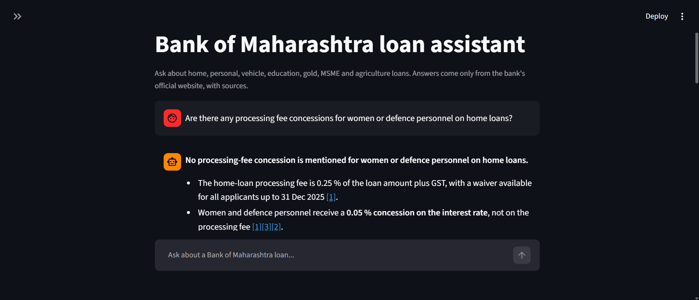

# Bank of Maharashtra Loan Product Assistant

A chat assistant that answers questions about Bank of Maharashtra loan products (home, personal, vehicle, education, gold, property, MSME and agriculture). It reads only pages from the bank's official site, `bankofmaharashtra.bank.in`. It finds the most relevant passages, asks a language model to answer from those passages only, and shows numbered sources for every claim. If a question is off-topic or the passages do not support an answer, it declines politely.




## 1. Demo

Real answers from the evaluation run on 2026-10-28 (hybrid retrieval, Groq `openai/gpt-oss-120b`). Each answer is shortened here; the full text is in `eval/results/2026-10-28_hybrid.md`.

| # | Question | Answer (short) | Correct? |
|---|---|---|---|
| 1 | What are the interest rates for a Bank of Maharashtra home loan? | Standard rate 7.25% p.a. and a 0.05% concession for women. | **Partly.** It missed the CIBIL-based range (7.25% to 9.40%/9.90%) and, before the number check was added, wrote "7.20%" for women, a number that is on no page. That figure is now removed automatically (see section 6). |
| 2 | What is the maximum tenure for a personal loan if my salary account is with the bank? | 84 months for Category A salaried customers with a salary account at the bank. | Yes |
| 3 | Tell me about the Maha Super Flexi Housing Loan Scheme. | Flexi savings-linked term loan; minimum Rs 50 lakh; LTV 80% up to Rs 75 lakh and 75% above; up to 30 years or age 75; rate is the Maha Super Housing Loan rate + 0.25%; processing fee 0.25% capped at Rs 25,000. | Yes (the page's own fee-waiver date, 30-Sep-2024, has passed) |
| 4 | Are there any processing fee concessions for women or defence personnel on home loans? | None mentioned. The 0.05% concession for women and defence personnel is on the interest rate, not the fee. | Yes |

An out-of-scope question ("What's the weather in Pune today?", "What is the SBI home loan interest rate?") gets a polite refusal with no model call.

## 2. Project Setup

**Prerequisites:** Python 3.12 or newer (built and tested on 3.13), git, and a free [Groq API key](https://console.groq.com). A [Gemini API key](https://aistudio.google.com) is optional; it is the fallback if Groq fails.

**Windows (PowerShell).** Clone into a short folder such as `C:\code`, or run `git config --global core.longpaths true` first: a few data files have long names and a deep path fails with "Filename too long".

```powershell
git clone https://github.com/Shantanu-0101/BoM-Loan-Assistant bom-loan-assistant
cd bom-loan-assistant
python -m venv .venv
.venv\Scripts\Activate.ps1
pip install -r requirements.txt
pip install -e .
copy .env.example .env      # then put your GROQ_API_KEY in .env
```

**macOS / Linux**

```bash
git clone https://github.com/Shantanu-0101/BoM-Loan-Assistant bom-loan-assistant
cd bom-loan-assistant
python3 -m venv .venv
source .venv/bin/activate
pip install -r requirements.txt
pip install -e .
cp .env.example .env        # then put your GROQ_API_KEY in .env
```

The cleaned data and the search index are already in the repo (`data/processed/`, `index/`), so you do not need to scrape anything. The first question downloads the small embedding model (BAAI/bge-small-en-v1.5) once.

**Run**

```bash
streamlit run app/streamlit_app.py                       # chat UI
python -m loan_assistant.ask "What is the maximum tenure for a personal loan if my salary account is with the bank?"
python -m loan_assistant.ask "..." --show-context        # also print the retrieved chunks
python -m loan_assistant.ask "..." --mode vector         # vector-only search (default: hybrid)
```

**Rebuild the data** (re-scrapes the live site politely: robots.txt respected, 1 s delay, cached)

```bash
python -m loan_assistant.build --all                     # scrape, process, chunk, index
python -m loan_assistant.build --step process            # or one step: scrape | process | chunk | index
python -m loan_assistant.build --step scrape --refresh   # ignore the page cache
```

The raw HTML is not in the repo (it is large and can be re-fetched); the extracted PDF text, `urls.csv` and `manifest.csv` are.

**Test, lint, evaluate**

```bash
pytest
ruff check .
ruff format --check .
mypy
python -m loan_assistant.evaluate --mode both            # vector and hybrid; answers are cached in eval/cache/
python -m loan_assistant.evaluate --mode hybrid --no-judge
```

Note: the free Groq tier allows about 8,000 tokens a minute for this model, and one answer costs about 2,500. Asking several questions in quick succession can hit that limit; wait a few seconds and ask again.

## 3. How it works

```
 bankofmaharashtra.bank.in
        |  scraping/   (sitemap + seed pages, robots.txt, cache, manifest)
        v
   raw HTML + PDFs
        |  processing/clean.py, pdf_text.py, consolidate.py
        v
   Markdown pages -> knowledge_base.md, loan_products.jsonl
        |  processing/chunk.py        (section-aware, tables kept whole)
        v
   chunks.jsonl (415) --embed (FastEmbed bge-small)--> FAISS index   +   BM25 keyword index
                                                             \                  /
 question --> guard (other bank? off-topic?) --> top 20 + top 20 --> RRF merge --> top 5 chunks
                                                                                      |
                                                  prompt with numbered context [1]..[5]
                                                                                      v
                                                  Groq gpt-oss-120b (Gemini if Groq fails)
                                                                                      v
                                      number check: drop any figure not in the retrieved text
                                                                                      v
                                       answer with [n] citations + source links + "as of" date
```

**In plain words:**
1. **Scrape.** The official loan pages and linked PDFs are scraped politely (robots.txt respected, a delay between requests), and everything that was fetched is saved with a manifest. The pages are mostly plain HTML, so `requests` and BeautifulSoup were enough. Selenium or Scrapy are mostly needed for JavaScript-heavy sites.
2. **Clean.** From each fetched page only the real text and tables are kept. Navigation menus, footers, scripts and widgets are removed.
3. **Chunk**. A whole page is too long to give a language model. So I cut each page into small pieces by its headings. I put the product name at the top of every piece. Without it, a piece that says “84 months” wouldn’t tell you it’s about a personal loan.
4. **Index.** A computer cannot search a chunk by meaning directly, so every chunk is turned into a list of numbers (an embedding) that captures its meaning, and stored in a FAISS index. I also keep a second index of the exact words (BM25), because searching by meaning can miss exact terms like "LAD" or "fixed deposit".
5. **Ask.** The question is searched in both indexes and each gives its best 20 chunks. The two lists are merged into one ranking (this is called Reciprocal Rank Fusion), and the best 5 chunks go to the language model with strict rules: use only these passages, do no arithmetic, and cite every sentence with its source number.
6. **Check the numbers.** After the model answers, a small piece of code checks that every figure in the answer is also written in those 5 passages or in the question. I added this because the model once wrote 7.20% for women by subtracting 0.05 from 7.25, a number that is on no page. A sentence with such a figure is removed, and the answer says that a figure was left out.
7. **Refuse.** If the question names another bank, or the best chunk is not similar enough to the question (similarity below 0.68), the assistant says it cannot find the answer instead of guessing. I chose 0.68 from 24 test questions: real loan questions scored 0.74 or more and off-topic ones 0.66 or less.

## 4. Architectural Decisions

| Decision | Why | Evidence |
|---|---|---|
| Official `bankofmaharashtra.bank.in` only, no blogs or aggregators | Rates and rules change; third-party pages are often stale or wrong, and an assistant that quotes rates must quote the bank. The fetcher even refuses off-site redirects. | Two live redirects to the retired `bankofmaharashtra.in` domain were recorded and not followed. |
| `requests` + BeautifulSoup, not Scrapy or Selenium | The pages are server-rendered HTML, the job is about 90 pages, and a small fetcher is easier to make polite and to test. | Raw pages held the content; only 12 pages are thin (see section 5), and those are short on the bank's site too. |
| Section-aware, table-safe chunks with a context header | Rate and fee answers live in tables; cutting a table mid-row or losing the product name gives wrong or empty answers. | 115 tables kept as Markdown. A hard cut happens only when one row alone is over 450 words (3 of 415 chunks). |
| FastEmbed `bge-small-en-v1.5` | Runs locally on CPU, free, no API quota, small enough to rebuild in seconds. | |
| FAISS flat index | 415 chunks: an exact search is instant, so an approximate index adds nothing. | |
| Hybrid BM25 + vector with RRF | Meaning search misses exact terms ("fixed deposit", "LAD"); keyword search misses paraphrase. | Table in section 6: hit@5 95% -> 100%, hand grade 88% -> 96%. Small sample, see caveats. |
| Groq `gpt-oss-120b`, Gemini as fallback | Free, fast (about 1 s per answer), and a second provider if one is down. | Gemini is tested as the fallback: with Groq's key rejected, it answered a real question with sources. It also grades answers as the evaluation judge. Its free tier is small (20 requests a day per model), so it is a backup, not the main model. |
| Streamlit | One file gives a chat UI with source links and a chunk viewer; the work is in retrieval, not in a front end. | |
| Refusal by similarity threshold (0.68) | Cheaper and safer than asking the model whether it knows. | Chosen from 24 probe questions: in-scope questions scored 0.74 or more, off-topic 0.66 or less. |

## 5. Data strategy

**Sources.** All pages come from `bankofmaharashtra.bank.in`. The full list, with HTTP status and checksum, is in `data/raw/urls.csv` and `data/raw/manifest.csv`. Sources by product area (pages kept after cleaning):

| Area | Pages | Examples |
|---|---|---|
| Home | 11 | `/personal-banking/loans/home-loan`, `/maha-super-flexi-housing-loan-scheme`, `/topup-home-loan`, `/pradhan-mantri-awas-yojana-2` |
| Personal | 8 | `/personal-loan-for-salaried-customers`, `/maha-adhaar-loan`, `/salary-gain-scheme` |
| Vehicle | 6 | `/maha-super-car-loan-scheme`, `/mahabank-vehicle-loan-scheme-for-two-wheelers-loans` |
| Education | 5 | `/educational-loans`, `/model-education-loan-scheme`, `/maha-bank-skill-loan-scheme` |
| Gold, property | 1 + 3 | `/gold-loan`, `/lad`, `/loan-against-property` |
| Rates and charges | 2 + 1 | `/retail-interest-rates`, `/service-charges` |
| MSME | 19 | `/msme-schematic-loans`, `/pradhan-mantri-mudra-yojana` |
| Agriculture | 19 | `/kisan-credit-card`, `/agri-gold-loan` |
| Other | 14 | rooftop solar, self-help groups, hotel and restaurant, and similar schemes |

**Cleaning.** Use the page's section panes or main container; drop navigation, footer, scripts, calculators and buttons; keep tables as Markdown (tables inside list items stay real tables; tables nested in cells are flattened to one line); keep FAQ questions as headings; normalise whitespace and Rs/INR/percent forms. PDFs are kept only if they are English text with real prose.

**Numbers (from `data/processed/stats.json`).**

| | |
|---|---|
| Pages kept | 86 HTML + 3 PDF |
| Words in the knowledge base | 72,441 (about 65,500 from the 86 web pages and about 6,900 from the 3 PDFs) |
| Page chrome removed | 186,662 of the 252,186 words visible on the raw web pages (74%): menus, headers, footers, buttons and similar |
| Sections / tables | 218 / 115 |
| Chunks | 415 |
| PDFs left out | 14 scanned (no text), 18 not English or garbled, 7 site-wide footer links, 2 blank forms, 1 too short or long |
| Pages thin after cleaning (under 100 words) | 12, listed in `stats.json` |

**Freshness.** Every answer ends with "Information as of 2026-10-28". That is the scrape date, not a guarantee that the bank has not changed anything since. Some pages themselves carry old dates (for example a fee waiver "until 30-Sep-2024"); the assistant reports what the page says.

## 6. Evaluation

**Method.** `eval/questions.jsonl` holds 25 questions: the 4 from the assessment, 18 about specific products (fees, tenure, margin, eligibility, documents), and 3 out of scope (another bank, savings account, weather). The key facts for each question were written by hand from the official pages, and a test checks that each one really appears on its expected page. The runner records, per question:

- **hit@5 / hit@1:** is the expected page among the 5 chunks sent to the model (or first)?
- **Key facts:** are all key facts in the answer (automatic string check)?
- **Hand grade:** 2 = correct and complete, 1 = partly correct, 0 = wrong, missing or wrongly refused. For out-of-scope questions, 2 = politely declined.
- **Refusal accuracy** and **latency**.

**Results (2026-10-28).**

| Metric | Vector only | Hybrid (BM25 + vector) |
|---|---|---|
| Retrieval hit@5 (22 in-scope) | 21/22 (95%) | 22/22 (100%) |
| Retrieval hit@1 | 17/22 (77%) | 19/22 (86%) |
| All key facts in answer (automatic) | 16/22 (73%) | 18/22 (82%) |
| **Hand grade 2, all 25** | 22/25 (88%) | **24/25 (96%)** |
| Gemini judge grade 2, all 25 (`gemini-3.5-flash-lite`) | 19/25 (76%) | 20/25 (80%) |
| Judge and hand grade agree | 22/25 (88%) | 21/25 (84%) |
| Out-of-scope refused | 3/3 | 3/3 |
| In-scope wrongly refused | 1 | 0 |
| Average latency | 2.17 s | 0.89 s |

Target was at least 80% correct; both modes meet it.

**Read these numbers carefully.**
- The hand grades in `eval/grades.csv` were read and confirmed by Shantanu (grader column). The only mistake found in the vector run is q13, which was wrongly refused; hybrid answers it.
- 25 questions is a small sample: one question is 4 points. The hybrid gain rests mainly on one question (q13).
- The latency gap is mostly model-side variation, not search cost; do not read it as "hybrid is faster".
- The Gemini judge (`gemini-3.5-flash-lite`) now gives 25 verdicts per mode. It is stricter than the hand grades because it also expects every key fact, including ones the question did not ask for: it marks q08 down for missing the 70% margin (the question asks age and amount), q14 for missing the 120 EMIs (the question asks what it is and who is eligible), and q05 for the bank's own "starts from 8.35%" wording. The judge is a second opinion from a small model, not ground truth. The first judge model, `gemini-flash-latest`, hit its free limit of 20 requests a day.
- One answer key (q02) lists "60 months" although 84 months fully answers the question. It was left unchanged so the key is not tuned after seeing answers.

**Honest failures.**
1. **q01, home-loan interest rate (both modes).** The assistant gives 7.25% but not the CIBIL-score range on `/retail-interest-rates`. That table chunk ranks 28th by meaning and 122nd by keywords: rate tables are mostly numbers, which embed poorly, and the page says "Housing Loan" where people say "home loan". Four fixes were tried and dropped (query prefix, synonym expansion, new chunk per scheme, best-rates-chunk lookup). In the hybrid run the model also wrote "7.20% for women" by subtracting 0.05 from 7.25, despite a prompt rule against arithmetic. That led to the number check (`rag/grounding.py`), which removed it; re-running the evaluation changed only two of 50 answers (this one and a "(15 years)" conversion in q12) and no score moved. The missing range is a retrieval problem, so a cross-encoder reranker or a structured rate table is the real fix.
2. **q13, loan against fixed deposit (vector).** The `/lad` page was not in the top 5, so the assistant said it could not find it. Hybrid found it at rank 4. This is the clearest case where keyword search helps.
3. **q10, education loan collateral (both modes).** Only the Model scheme was mentioned; the no-collateral Maha Scholar scheme (up to Rs 40 lakh) was missed in the vector run.
4. **Gold-loan rate.** The bank's own page says 8.75% in the headline and "starts from 8.35%" lower down. The assistant reports both. That is faithful, not a bug.

## 7. Challenges Faced

The full list, with timestamps, is in `docs/ERROR_LOG.md`.

- **Site unreachable from my laptop:** the Wi-Fi gave only IPv6; the site's IPv6 address timed out. Found with raw socket tests and `curl -4/-6`; fixed by changing network.
- **Sitemap would not parse:** a UTF-8 byte-order mark at the start of the XML.
- **Spec page paths did not match the real site:** only home, personal and car loans sit under `/personal-banking/loans/`; the rest are flat slugs. I classified pages from the real 1,333-URL sitemap.
- **Redirects to a dead domain:** `/msme` and `/agriculture` redirect to the retired domain; the fetcher now records this and does not follow off-site redirects.
- **Page structure:** an unclosed `heading-wrap` div swallowed a whole article (588 words became 0); FAQ questions were `<button>` elements and were silently dropped; rate tables inside list items were flattened to unreadable text.
- **PDFs:** 14 are scans with no text; a garbled Indic-script PDF passed the first "is it English" test and had to be caught with a stricter check.
- **Model quirks:** citations written as `【2】` or `[1†L4-L5]` left the Sources list empty; the model invented a number by subtraction.
- **Free-tier limits:** Groq's 8,000 tokens a minute, not the request limit, is the binding one; Gemini once took 407 s to say "OK", so every provider now has a 30 s timeout.
- **Type checking added late:** `mypy` found 32 errors in the first three phases that `ruff` and `pytest` had not.

## 8. AI Tools Used

Claude Code (Sonnet) wrote most of the code and tests under my direction; Groq `gpt-oss-120b` is the runtime answer model; Gemini is the fallback and the judge. The full log, one row per tool and phase, is in [`docs/AI_TOOLS_LOG.md`](docs/AI_TOOLS_LOG.md). Details, one row per tool and phase, are in [`docs/AI_TOOLS_LOG.md`](docs/AI_TOOLS_LOG.md).

## 9. Potential Improvements

- A cross-encoder reranker, and a structured rate table with direct lookup for rate questions (fixes the q01 weakness).
- OCR for the 14 scanned PDFs.
- Scheduled re-scrape with change detection, so "as of" dates stay current.
- Query rewriting ("home loan" -> "housing loan"), conversation memory, Hindi and Marathi.
- A larger evaluation set with independent graders, and a stronger LLM judge with key facts matched to each question.
- Deployment, monitoring and rate-limit handling for many users.

## 10. Limitations & disclaimer

- Answers come only from pages scraped on 2026-10-28. Rates, fees and schemes change; some pages are themselves out of date.
- The assistant can still make mistakes. The number check only catches a wrong figure, not a wrong or unsupported statement in words, and it does not catch an invented whole number below 10 without a unit. Always check the cited source.
- Rate questions are the weakest area (see section 6).
- 12 pages are thin after cleaning; scanned PDFs are not read.
- English only. Free-tier API limits apply.
- **This is an assessment project, not affiliated with Bank of Maharashtra. It is not financial advice. Confirm all terms with the bank before making a decision.**
